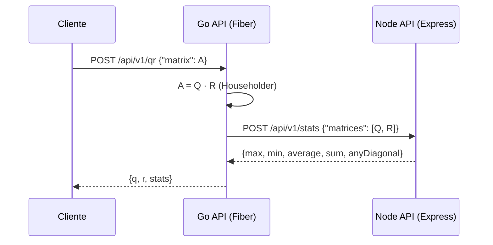

# 01 — El problema, explicado sin jerga

## ¿Qué nos piden?

Dos APIs que trabajan en cadena:

1. Una API en **Go** recibe una tabla de números (una *matriz*), la **factoriza** con el método **QR** y obtiene dos tablas nuevas: **Q** y **R**.
2. Envía Q y R a una API en **Node**, que calcula estadísticas sobre todos sus números: máximo, mínimo, promedio, suma total y si alguna de las tablas es **diagonal**.
3. Go devuelve al cliente Q, R y las estadísticas.



Versión ASCII:

```
Cliente ──A──▶ Go (calcula Q y R) ──Q,R──▶ Node (estadísticas)
   ▲                                          │
   └──────────── {q, r, stats} ◀──────────────┘
```

## Una matriz es una tabla de Excel

Una matriz es simplemente una tabla rectangular de números, como una hoja de Excel:

```
A = | 3  0 |    fila 1
    | 4  5 |    fila 2
     col1 col2
```

"Rectangular" significa que todas las filas tienen la misma cantidad de columnas. Puede tener más filas que columnas, más columnas que filas, o igual cantidad (cuadrada).

## Factorizar es partir en piezas que se multiplican

Así como `12 = 3 × 4`, factorizar una matriz es escribirla como el producto de dos matrices más simples:

```
A = Q × R
```

Cada pieza cuenta algo distinto, igual que 3 y 4 cuentan algo distinto de 12.

## Cada columna es una flecha en un mapa

Toma la primera columna de A: `(3, 4)`. Imagínala como una flecha en un mapa: 3 pasos al este y 4 al norte.

- ¿Cuánto mide la flecha? Es el triángulo clásico 3-4-5: **mide 5**.
- ¿Hacia dónde apunta? Si la "encogemos" a longitud 1, queda `(3/5, 4/5) = (0.6, 0.8)`. Eso es **solo la dirección**.

## Q es la brújula, R es el podómetro

- **Q (la brújula)**: guarda solo **direcciones**. Sus columnas son flechas de longitud 1 y perpendiculares entre sí (como norte y este). No dice "cuánto", solo "hacia dónde".
- **R (el podómetro)**: guarda **cuántos pasos** dar en cada dirección de la brújula para reconstruir cada columna original.

Multiplicar Q por R es decir: "camina R pasos en las direcciones de Q" y llegas exactamente a A.

## Ejemplo resuelto a mano: A = [[3,0],[4,5]]

**Primera columna** `(3, 4)`:
- longitud 5 → `R[0][0] = 5`
- dirección `(0.6, 0.8)` → primera columna de Q.

**Segunda columna** `(0, 5)`:
- ¿Cuántos pasos de ella van en la dirección `(0.6, 0.8)`? `0·0.6 + 5·0.8 = 4` → `R[0][1] = 4`.
- Le quitamos esa parte: `(0,5) − 4·(0.6,0.8) = (−2.4, 1.8)`. Mide `3` → `R[1][1] = 3`.
- Su dirección: `(−2.4/3, 1.8/3) = (−0.8, 0.6)` → segunda columna de Q.

Resultado:

```
Q = | 0.6  -0.8 |      R = | 5  4 |
    | 0.8   0.6 |          | 0  3 |
```

Comprobación (fila 1 de Q por columnas de R): `0.6·5 + (−0.8)·0 = 3` ✓, `0.6·4 + (−0.8)·3 = 0` ✓.

## ¿Por qué nuestra API devuelve signos opuestos?

Nuestra API usa el método de **Householder** (reflexiones, como espejos). Para el mismo A devuelve:

```
Q = | -0.6  -0.8 |      R = | -5  -4 |
    | -0.8   0.6 |          |  0   3 |
```

Ambas respuestas son correctas. Si das la vuelta a una flecha de la brújula (cambias su signo) y también das la vuelta al número de pasos en esa dirección, llegas al mismo lugar:

```
(−Q) · (−R) = Q · R = A
```

Householder elige el signo que evita restar números casi iguales, lo que lo hace más preciso con decimales. Por eso los signos pueden diferir del cálculo a mano.

## "Diagonal" y "triangular" con ejemplos chiquitos

- **Diagonal**: solo hay números en la diagonal principal (de arriba-izquierda a abajo-derecha); el resto es 0.

  ```
  | 2 0 |   diagonal          | 2 1 |   NO diagonal
  | 0 7 |                     | 0 7 |
  ```

  En nuestra API una matriz no cuadrada también puede ser "diagonal" si todo lo que está fuera de la posición `i = j` es 0 (por ejemplo `[[1,0,0],[0,2,0]]`).

- **Triangular superior**: todo lo que está **debajo** de la diagonal es 0. R siempre es así.

  ```
  | 5 4 |
  | 0 3 |
  ```

Como las computadoras calculan con decimales finitos, a veces aparece `0.0000000000000001` en vez de 0. Por eso consideramos "cero" a cualquier valor con `|x| ≤ 1e-9`.

## Estadísticas del ejemplo

Valores de Q y R (salida de Householder): `-0.6, -0.8, -0.8, 0.6, -5, -4, 0, 3` (8 números).

| Estadística | Valor |
|---|---|
| suma | −7.6 |
| promedio | −7.6 / 8 = −0.95 |
| máximo | 3 |
| mínimo | −5 |
| ¿alguna diagonal? | no (Q tiene −0.8 fuera de la diagonal; R tiene −4) |
